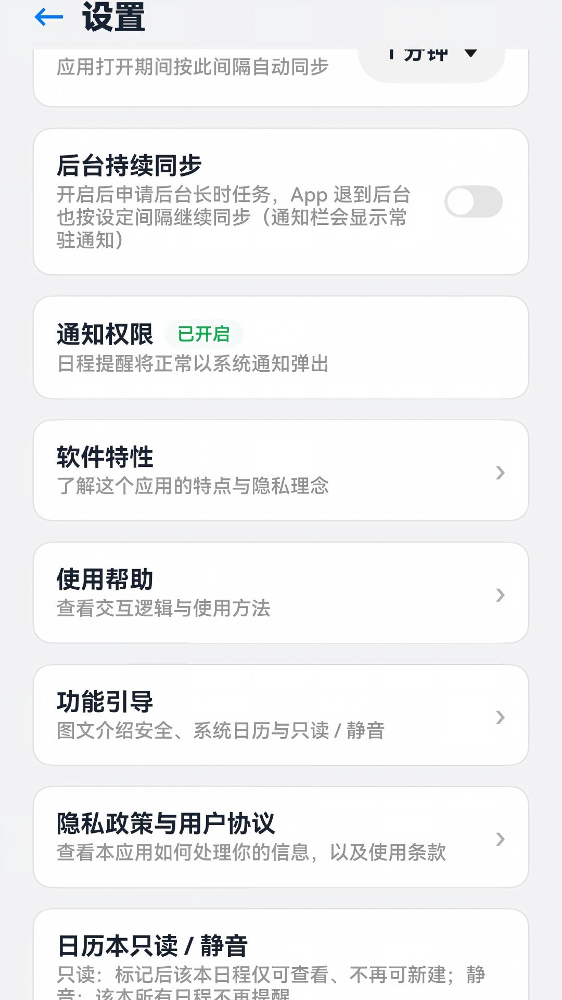
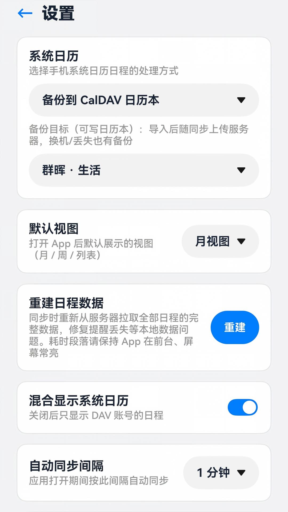
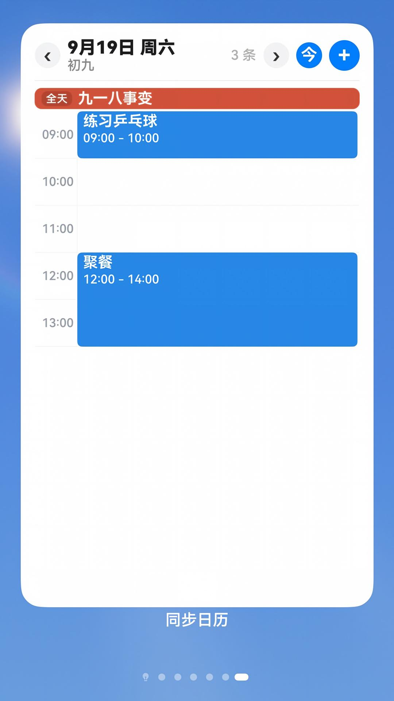
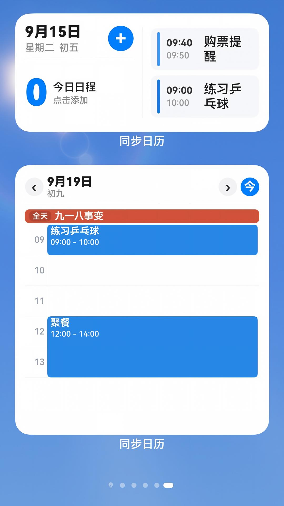
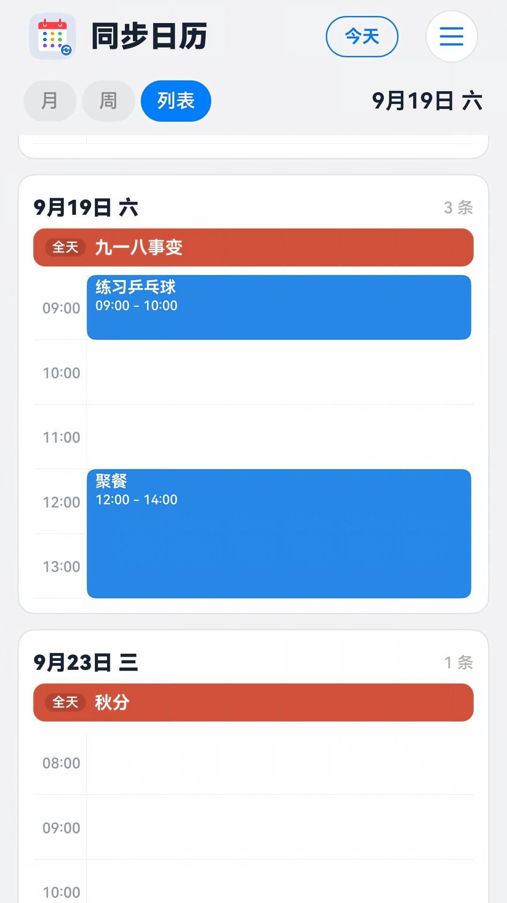
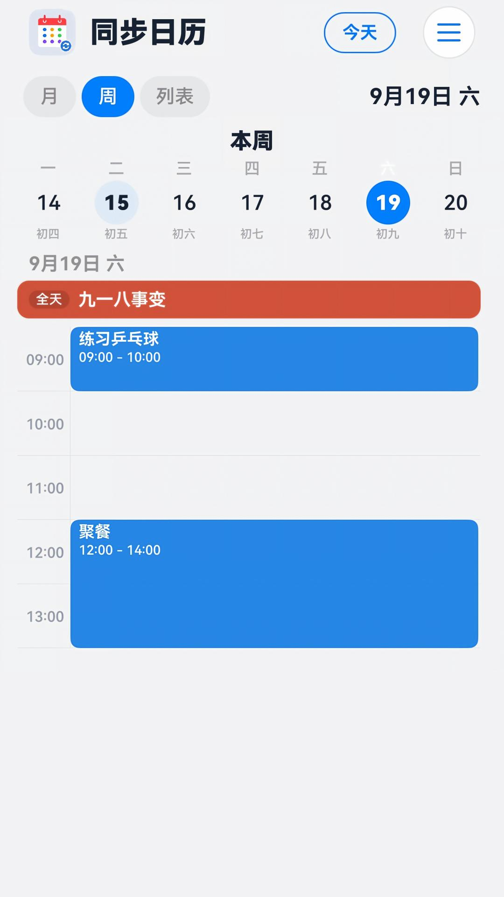
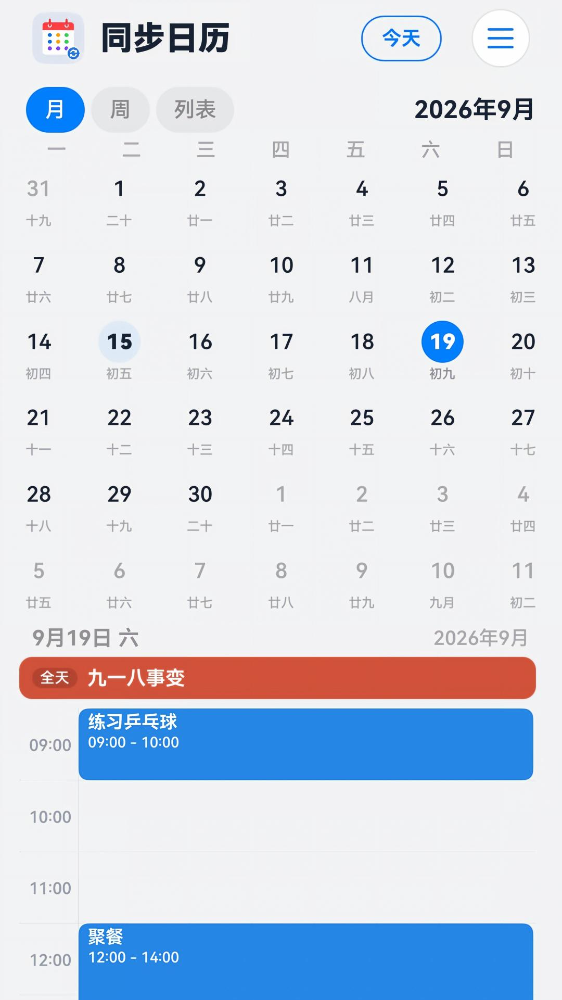
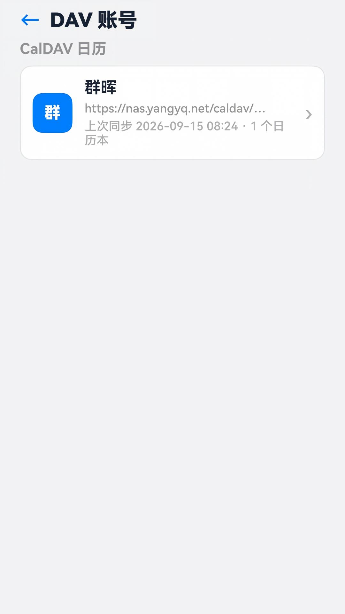

# SyncCalendar（同步日历）

一款以**同步为核心**的鸿蒙原生日历应用，基于 HarmonyOS NEXT（ArkTS / Stage 模型）开发。对接标准 CalDAV 服务器（群晖、Nextcloud、Radicale、Baikal 等），让你的日程真正掌握在自己手里——不经过第三方云服务，数据始终同步在你自己的 NAS 上。

- 应用市场送审版本：**0.1.0** ｜ 仓库当前：**0.1.1**（versionCode 10001）
- 官网：<https://synccalendar.yangyq.net> ｜ 问题反馈：<https://synccalendar.yangyq.net/feedback/>
- 开源协议：Apache License 2.0

---

## 📝 最近更新

### v0.1.1 (2026-10-30)
- 🚀 **卡片跳转直达**：点击桌面 2x4、4x4、6x4 服务卡片上的指定日程或分组时，拉起应用直接定位至对应日程所在日期并联动时间轴。
- ⚡ **滑动防闪跳优化**：优化月视图 Swiper 页面轮播机制，由动画结束回调接管静默回正与缓存填充，彻底消除翻页时的闪跳与日期突变。
- 🔴 **日程标记红点稳定性**：修复日历格子中日程标记红点在翻页滑动或冷启动时偶发丢失的问题；引入渲染感知状态 key 并扩大跨月前后数据缓存。
- 🛠️ **启动并发与查询性能**：增加 isLoadingAll 数据加载防重锁，建立按天哈希索引表（O(1) 查找），大幅减少无谓计算和界面卡顿。

---

## ✨ 功能特性

### CalDAV 同步

- 完整协议链路：**PROPFIND** 发现日历本 → **REPORT** 全量拉取 → **ETag** 增量比对 → **PUT / DELETE** 双向推送
- 一个账号可挂载多个日历本，按需勾选同步范围；支持在线编辑账号、重选日历本、删除账号
- 解析 **VEVENT / VTODO / VALARM / RRULE / EXDATE / RECURRENCE-ID**，重复日程的**单次覆盖实例**也能正确还原
- 支持 VTODO 待办同步（只读展示，不参与推送）
- 「重建日程数据」可强制整表重拉，用于修复提醒丢失等本地数据问题

### 日历视图与交互

- **月 / 周 / 列表** 三种视图（顶部标签切换，也支持左右滑动手势）；默认视图可在设置里指定
- 月视图三页 Swiper 左右翻月、显示**农历**（初一显示月名），点击查看当日日程
- 周视图支持按天左右滑动切换日期，跨月自动重载
- 列表视图按天分组、今日置顶，配合 List 虚拟化保证长列表流畅
- 日程显示方式两种：**竖向时间轴**（按时间刻度看一天的占用与冲突，带当前时间红线）／**列表**（快速扫读，适合长标题）
- 重复日程（RRULE）按规则完整展开：DAILY / WEEKLY / MONTHLY / YEARLY 及 INTERVAL、BYDAY、UNTIL、EXDATE 等
- 可选**混合显示系统日历**，并与 DAV 数据自动去重
- 点击日程里的「地点」可**拉起高德 App 路线规划**（系统地理编码 + WGS84→GCJ02 坐标转换，地址文本不落日志）

### 日程编辑与提醒

- 新建 / 编辑 / 删除日程并推送回服务器，支持全天日程、地点、描述、重复规则、多级提前提醒
- **地点搜索补全**：在「地点」栏输入关键词即可列出匹配地点（华为 Map Kit / Site Kit），点一下填入完整地址；也可点「地图」进入系统地图界面搜索、拖动图钉选点。**不申请任何定位权限**，手动输入同样可用
- **一键导航**：日程详情中点击「导航 ›」，用系统地理编码把地点地址换算为坐标后唤起高德地图；未安装则回退网页版。**不申请定位权限**（`getAddressesFromLocationName` 无需该权限），不会读取设备实时位置
- **必填项校验强提醒**：未填标题等必填项时，以 Toast + 输入框标红 + 自动滚回定位三管齐下提示，不会出现"提示在屏幕外看不到"的情况
- 自动读取服务器端 **VALARM** 提醒（如"开始前 10 分钟"）
- 基于**系统级代理提醒**（`reminderAgentManager`）发送通知，App 被杀、手机重启后依然生效，通知可右滑删除
- 保存带提醒的日程时会**在那一刻**申请通知权限；被拒绝也不影响日程保存，之后可在设置页再开启

### CalDAV 地址自动发现

- 只填服务器域名也能用：按标准 **`/.well-known/caldav`** 自动发现端点，并在常见路径（Nextcloud、群晖等）中依次尝试
- 发现时只认 `resourcetype` 含 `calendar` 的集合，避免把 DAV 根或分享链接误当成日历
- 失败时给出**人话错误提示**（如"正确形式通常为 `https://域名/remote.php/dav/calendars/用户名/`"），而不是抛原始状态码

### 系统日历镜像（可选增强，默认关闭）

镜像是**可选项**，App 本体不依赖它也能完整使用。开启后：

- **镜像到系统日历**：把选中的 CalDAV 日历本写入系统日历，这样**小艺语音、桌面日历卡片和手表**也能看到你的日程。每个日历本在系统日历里是**独立账户**，可单独设色与隐藏
- **把系统日历的改动回写**：你在系统日历里新建、修改、删除的日程，同步回指定的 CalDAV 日历本（相当于把本机日程备份到服务器）
- 采用**星型架构**：服务器 ↔ 本地库、本地库 ↔ 系统日历各做一次两方同步，不会互相污染
- 日历本用**稳定的 bookId**（`账号ID-资源路径哈希`）标识，不随勾选顺序变化；取消勾选、目标失效时会自动关闭备份并把相关账户清理干净，绝不把日程写进你没选过的日历本
- 重复日程不写入系统 `recurrenceRule`，而是按时间窗口自行展开（过去 1 年 ~ 未来 2 年），保证 `RECURRENCE-ID` 覆盖与 `EXDATE` 排除精确对应

### 桌面服务卡片

- 四种规格：**2×2 / 2×4 / 4×4 / 6×4**，时间轴样式设计
- 按天分组展示未来日程，组内全天事件置顶；跨天日程智能归入"今天"，标注"全天"
- 每条日程左侧竖条颜色与日历本一致，右侧显示所属日历本名
- 同步完成后自动刷新，`formId` 持久化保证 App 重启后推送不丢

### 后台同步与数据备份

- **前台自动同步**：App 在前台时按设定间隔自动同步（可设 1 / 5 / 15 / 30 分钟）
- **后台自动同步**：开启后由系统定时唤起同步，退到后台也会继续（受系统省电策略限制，**最短约 2 小时一次**）
- **回到前台 / 网络恢复补同步**：切回应用、或从断网恢复到有网时，**立即补同步一次**，保证你打开日历时数据总是最新的
- **应用数据备份/恢复**：接入 Backup 扩展能力，换机时可恢复账号与本地数据

> 说明：HarmonyOS 出于省电考虑，**不允许普通应用在后台常驻并高频轮询**
> （长时任务 `dataTransfer` 超过 10 分钟无进度即被系统取消，延迟任务存在小时级下限）。
> 本应用遵循系统机制，采用「前台按间隔同步 + 后台定时唤起 + 回前台/网络恢复即时补同步」的分层组合。

### 界面与适配

- **深色模式**：全程使用资源引用（`$r('app.color.*')`），深浅两套色板一一对应，跟随系统自动切换
- **沉浸式**：系统状态栏与导航栏全透明，每页（含内置文档页）都做了安全区扩展
- **大屏与横竖屏**：以**窗口短边是否达到 840vp** 作为大屏判据（而非屏幕方向），因此折叠屏展开态、平板可自由横竖屏切换，而在屏幕比例接近 1:1 的设备上旋转时布局保持一致
- **转场动效**：所有页面使用系统转场，淡入淡出 + 弹簧曲线（`curves.springMotion`），不做单帧直切、左右平移或上下位移

### 设置项一览

系统日历处理方式（仅显示 / 备份到 CalDAV）· 镜像到系统日历 · 选择要镜像的日历本 · 回写开关 · 默认视图 · 日程显示方式 · 自动同步间隔 · 后台自动同步 · 通知权限 · 混合显示系统日历 · 日历本只读 / 静音 · 重建日程数据 · 重置账号库 · 软件特性 · 使用帮助 · 隐私政策与用户协议

---

## 🔒 隐私

我们遵循"**数据自持、最小必要**"原则：

- 开发者**不保存**你的日程与账号数据（账号密码只存在本机，且以 **AES-256-GCM** 加密存储，密钥由系统 HUKS/TEE 保管、不可导出）
- **不收集**通讯录、相册、剪贴板等信息，**不含**任何第三方统计或广告 SDK
- 页面从不展示他人邮箱；日志对日程标题、地点等敏感字段做**脱敏**处理
- **不申请定位权限**：本应用从不读取设备实时位置。「一键导航」所需的坐标由系统地理编码服务按**你填写的地址文本**换算，故 `module.json5` 中不含 `LOCATION` / `APPROXIMATELY_LOCATION`
- 地点关键词检索由 HarmonyOS 系统能力**华为地图服务**（Map Kit / Site Kit）提供，仅用于检索，不用于广告、画像或统计分析
- 权限**按需申请**：只有当你主动使用某个功能（如开启镜像、设置提醒）时才弹窗申请，启动、首启、同意隐私政策时都**不会**提前申请
- 权限被拒绝后，对应功能默认关闭，可随时在系统设置或本应用设置页重新开启

---

## 🛠 技术要点

- **架构**：`SyncEngine` 同步引擎 + `DavClient`（HTTP / WebDAV）+ `EventDb`（relationalStore 本地库）+ `CalendarDataService`（多源合并展示）
- **镜像**：`SystemCalendarMirror`（出站写入）+ `MirrorInbound`（入站回写）+ `MirrorSnapshot`（变更快照）
- **后台调度**：`BackgroundSyncRunner`（后台同步唯一执行体）+ `BackgroundSyncService`（延迟任务/短时任务）+ `NetworkSyncWatcher`（网络恢复补同步）
- **卡片**：FormExtensionAbility + FormBindingData，JSON 数据驱动渲染
- **农历**：`LunarUtil`，1901–2099 压缩表推算
- **提醒**：`ReminderService` 基于 `reminderAgentManager` 代理提醒
- **权限**：INTERNET / READ_CALENDAR / READ_WHOLE_CALENDAR / WRITE_CALENDAR（仅镜像）/ PUBLISH_AGENT_REMINDER / LOCATION（仅地点导航时）

### 目录结构

```
SyncCalendar/
├─ AppScope/                    应用级配置（包名、版本号）
└─ entry/src/main/
   ├─ ets/
   │  ├─ common/                核心能力
   │  │  ├─ SyncEngine.ets          同步引擎（拉取 → 解析 → 落库 → 推送）
   │  │  ├─ DavClient.ets           CalDAV / WebDAV 协议客户端
   │  │  ├─ EventDb.ets             relationalStore 本地库
   │  │  ├─ IcsUtil.ets             ICS 解析与生成
   │  │  ├─ RruleUtil.ets           重复规则展开
   │  │  ├─ CalendarDataService.ets 多源合并、系统日历读取
   │  │  ├─ SystemCalendarMirror.ets / MirrorInbound.ets / MirrorSnapshot.ets
   │  │  ├─ ReminderService.ets     代理提醒
   │  │  ├─ CardDataService.ets     卡片数据
   │  │  ├─ AppSettings.ets / AccountStore.ets
   │  │  └─ LunarUtil.ets / TimelineUtil.ets / DocViewer.ets / TipsPanel.ets …
   │  ├─ pages/                 Index / Accounts / AddAccount / CalendarList /
   │  │                         EditAccount / EventEdit / Settings + widget/*
   │  ├─ entryability/          主能力
   │  ├─ entrybackupability/    应用数据备份恢复
   │  ├─ entryformability/      桌面卡片
   │  └─ syncwork/              后台定时同步（WorkScheduler 扩展能力）
   └─ resources/                base / dark 两套资源与颜色
```

---

## 📦 构建与运行

### 一、准备工程

1. 安装 **DevEco Studio**（建议 5.0 及以上，需配套 HarmonyOS NEXT SDK）
2. 用 DevEco Studio 打开工程根目录，等待自动同步（`ohpm install`）完成
3. 连接鸿蒙真机（需 HarmonyOS NEXT）或模拟器

### 二、首次构建：先补上签名配置（重要）

> **为什么需要自己配？**
> 鸿蒙应用在编译安装与上架时都必须签名。工程根目录的 **`build-profile.json5`** 里记录了
> 签名文件的**绝对路径与加密口令**，属于机器相关且敏感的凭据，因此该文件**被 `.gitignore` 排除、不在仓库中**。
> 你从仓库克隆下来的代码默认**不含任何签名信息**，直接编译会失败。下面是补全方法。

#### 1. 需要准备哪些文件

签名一共涉及 **4 个文件**，全部放在仓库**之外**的某个目录里（例如 `D:\DevEcoSign\`）：

| 文件 | 格式 | 说明 |
|---|---|---|
| 密钥库 | `.p12` | 存放你的私钥与证书链，**最关键、绝不能泄露** |
| 证书 | `.cer` | 与密钥库配套的应用证书 |
| Profile | `.p7b` | 授权档案，决定该包能装到哪些设备 / 能否上架 |
| （口令） | — | 密钥库口令、私钥口令（在生成时自己设定，请务必记牢） |

#### 2. 这些文件怎么申请、怎么得到

有两种途径，按你的目的选一种：

**途径 A：调试用（自用真机安装）—— 全自动，推荐**

DevEco Studio 可以一键生成并自动完成签名配置，无需手工操作：

1. 打开 `File → Project Structure → Project → Signing Configs`
2. 勾选 **`Automatically generate signature`**（自动生成签名）
3. 按提示登录你的**华为开发者账号**（需先在 [AppGallery Connect](https://developer.huawei.com/consumer/cn/) 完成实名认证）
4. 等待自动完成——DevEco 会替你：生成 `.p12` 密钥库与 `.cer` 证书 → 向华为**申请调试 Profile（`.p7b`）**
   并自动注册当前设备 → 把 `signingConfigs` 写入 `build-profile.json5`
5. 生成的文件默认落在 `C:\Users\<你>\.ohos\config\` 下

> 这是最省事的方式，**只要一个已实名认证的华为开发者账号**即可，不需要额外审批。

**途径 B：上架用（发布到应用市场）—— 需在 AGC 后台申请**

若要打**上架包**（`.app`），必须使用**发布证书 + 发布 Profile**，需手动申请：

1. 登录 [AppGallery Connect](https://developer.huawei.com/consumer/cn/)，进入
   `用户与访问 → 证书管理`，创建并下载：
   - **发布证书（`.cer`）**——需先在本机用 `keytool` 或 DevEco 生成一个 `.p12` 密钥库，
     再上传其生成的 **CSR 文件**申请证书；
   - **发布 Profile（`.p7b`）**——在 `证书、APP ID 和 Profile → Profile` 中新建，
     类型选 **发布（Release）**，关联上面的证书与你的 App ID。
2. 记住创建密钥库时设定的**密钥库口令**与**私钥口令**。

> 官方文档入口：AppGallery Connect → 帮助中心 → **「配置应用签名」** / 「证书管理」。

#### 3. 在哪个文件里填写

在**仓库根目录**新建 `build-profile.json5`（就是被忽略的那份），填入你的签名信息。
可直接复制仓库中的模板 **`build-profile.example.json5`** 改名为 `build-profile.json5` 后使用，格式如下：

```json5
{
  "app": {
    "signingConfigs": [
      {
        // 调试配置：真机安装用这项
        "name": "default",
        "type": "HarmonyOS",
        "material": {
          "storeFile":    "D:/DevEcoSign/your.p12",        // ← 改成你的密钥库绝对路径
          "storePassword": "<你的密钥库口令>",              // ← 自动生成时是一段密文
          "keyAlias":     "your_key_alias",                 // ← 密钥别名（生成时指定）
          "keyPassword":  "<你的私钥口令>",                 // ← 同上
          "signAlg":      "SHA256withECDSA",
          "profile":      "D:/DevEcoSign/yourDebug.p7b",    // ← 调试 Profile
          "certpath":     "D:/DevEcoSign/yourDebug.cer"     // ← 配套证书
        }
      },
      {
        // 上架配置：打 .app 包用这项（真机安装勿用）
        "name": "release",
        "type": "HarmonyOS",
        "material": {
          "storeFile":    "D:/DevEcoSign/your.p12",
          "storePassword": "<你的密钥库口令>",
          "keyAlias":     "your_key_alias",
          "keyPassword":  "<你的私钥口令>",
          "signAlg":      "SHA256withECDSA",
          "profile":      "D:/DevEcoSign/yourRelease.p7b",  // ← 发布 Profile
          "certpath":     "D:/DevEcoSign/yourRelease.cer"   // ← 发布证书
        }
      }
    ],
    "products": [
      {
        "name": "default",
        "signingConfig": "default",        // 用哪套签名：debug 用 "default"，上架改 "release"
        "targetSdkVersion": "26.0.0",
        "compatibleSdkVersion": "6.1.1(24)",
        "runtimeOS": "HarmonyOS",
        "buildOption": {
          "strictMode": { "caseSensitiveCheck": true, "useNormalizedOHMUrl": true }
        }
      }
    ],
    "buildModeSet": [ { "name": "debug" }, { "name": "release" } ]
  },
  "modules": [
    { "name": "entry", "srcPath": "./entry",
      "targets": [ { "name": "default", "applyToProducts": [ "default" ] } ] }
  ]
}
```

**关键位置说明：**

| 位置 | 作用 |
|---|---|
| `signingConfigs[].material.*` | 四个签名文件的**绝对路径**与两个口令 |
| `products[0].signingConfig` | 选哪套签名：真机安装填 `"default"`，打上架包填 `"release"` |

> ⚠️ **`build-profile.json5` 已在 `.gitignore` 中，请勿提交**。
> 若用「途径 A」自动生成，DevEco 会自动创建并填好该文件，你通常无需手写。
> 注意：`entry/build-profile.json5` 是**模块级**普通构建配置（不含密钥），它在仓库中是**需要保留**的，两者不要混淆。

#### 4. 一个更省事的替代做法

如果不想手写，也可以直接在 DevEco Studio 里操作：
`File → Project Structure → Project → Signing Configs`，勾选 `Automatically generate signature`
并登录华为开发者账号——DevEco 会自动把 `build-profile.json5` 生成好，随后直接编译即可。

### 三、编译运行

1. 点击 DevEco Studio 的 **Run ▶**，或执行：

   ```bash
   hvigorw assembleHap --mode module -p product=default
   ```

2. 安装后进入「≡ → 账号管理」，添加 CalDAV 服务器地址、用户名和密码
3. 选择要同步的日历本，等待首次同步完成
4. 长按桌面空白处 → 添加服务卡片，选择 SyncCalendar 的卡片规格

### 四、打上架包（App Pack）

应用市场上架需要提交 **`.app`（App Pack）**，而不是 `.hap`（`.hap` 仅用于真机侧载）：

```bash
hvigorw assembleApp --mode project -p product=default -p buildMode=release
```

- 产物：`build/outputs/default/SyncCalendar-default-signed.app`
- **前提**：请先把 `products[0].signingConfig` 改为 `"release"`（用发布证书 + 发布 Profile），
  否则会因签名不匹配而无法通过审核。
- 校验签名（可选，`-inForm zip` 不可省，否则会误报 `can not find codesign block`）：

  ```bash
  java -jar hap-sign-tool.jar verify-app -inForm zip \
       -inFile SyncCalendar-default-signed.app \
       -outCertChain out.cer -outProfile out.p7b
  ```

  出现 `verify-app success` 即表示签名有效。

---

## 📷 截图

| 月视图 | 周视图 |
|---|---|
|  |  |

| 列表 / 时间轴 | 日程详情 |
|---|---|
|  |  |

| 设置 | 账号管理 |
|---|---|
|  |  |

| 桌面卡片 | 深色模式 |
|---|---|
|  |  |

---

## 🔗 相关链接

| | |
|---|---|
| 官方网站 | <https://synccalendar.yangyq.net> |
| 使用帮助 | <https://synccalendar.yangyq.net/uh.html> |
| 软件特性 | <https://synccalendar.yangyq.net/sf.html> |
| 隐私政策 | <https://synccalendar.yangyq.net/upa.html> |
| 用户服务协议 | <https://synccalendar.yangyq.net/usa.html> |
| 问题反馈 | <https://synccalendar.yangyq.net/feedback/> |

网站备案：**鲁ICP备17014997号-6A**

---

## 📄 开源说明

本项目仅供学习交流使用，采用 **Apache License 2.0** 协议，详见 [LICENSE](LICENSE)。

该项目使用人工智能辅助完成。
